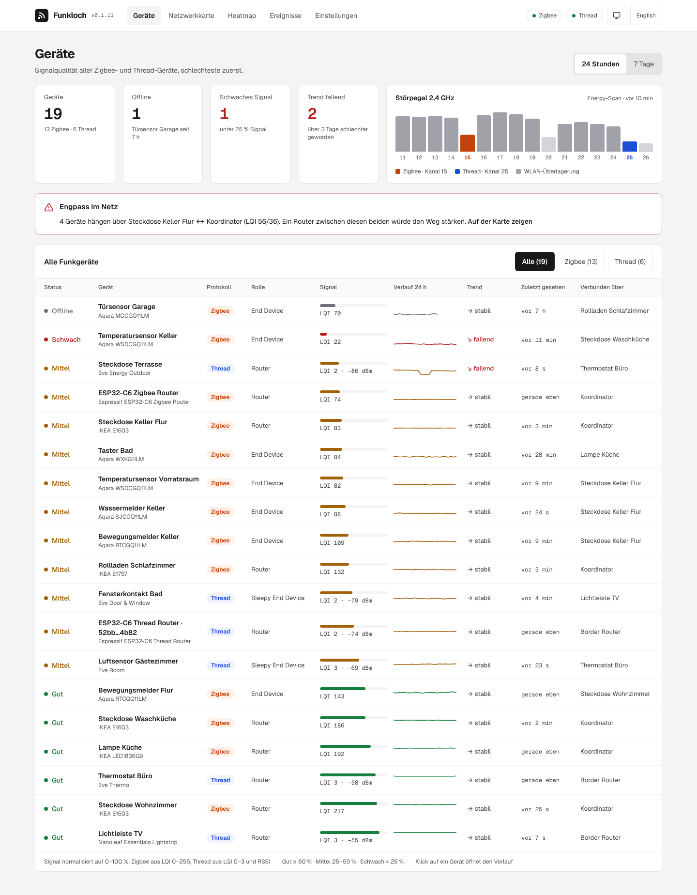
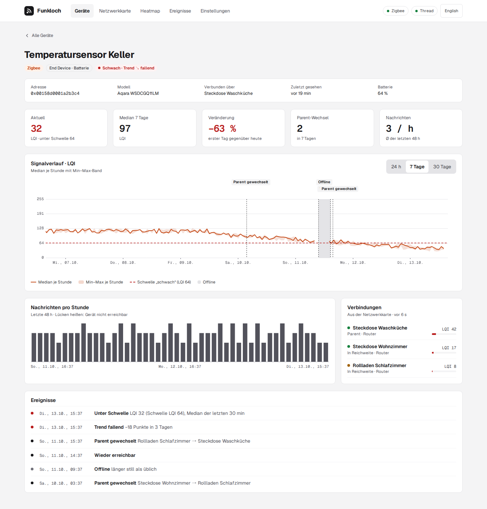
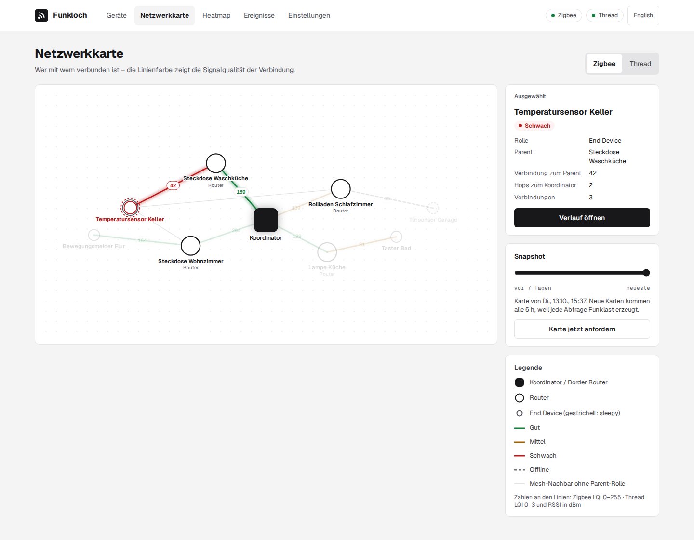
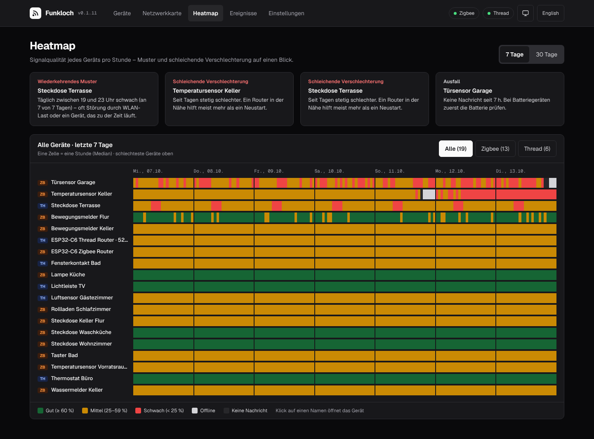
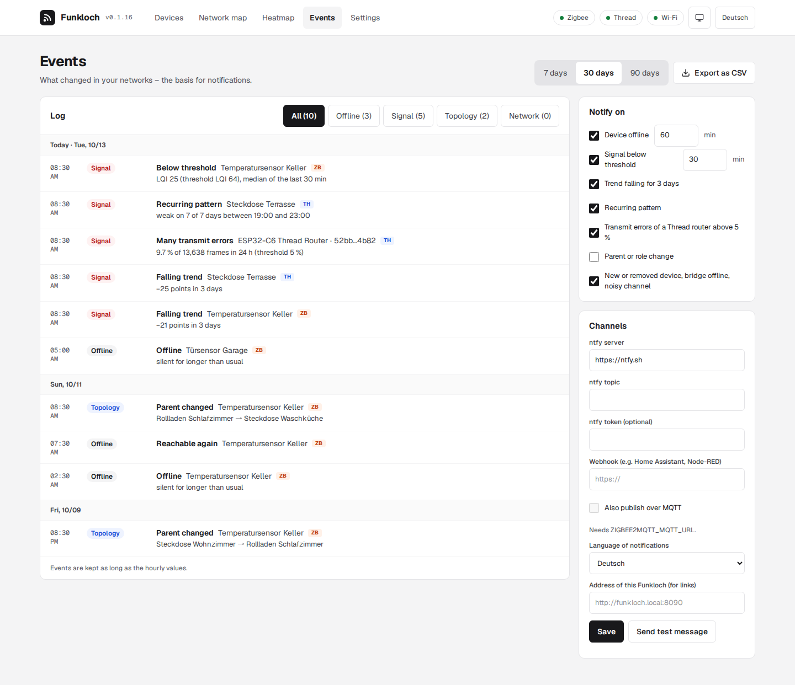

<div align="center">


<h1>Funkloch: signal history for Zigbee2MQTT and Thread devices</h1>

**A self-hosted dashboard that records the signal quality of every Zigbee2MQTT and Thread (OpenThread Border Router) device over time.**<br>
It shows which devices get worse over days, which drop out and how they are connected, instead of one snapshot.<br>
One Docker container next to Zigbee2MQTT and your OTBR, read-only, no cloud, open source.

[](https://github.com/firsttris/funkloch/actions/workflows/ci.yml)
[](https://github.com/firsttris/funkloch/releases/latest)
[](https://hub.docker.com/r/tristanteu/funkloch)
[](https://firsttris.github.io/funkloch/)
[](LICENSE)
<br>
[](https://firsttris.github.io/funkloch/zigbee2mqtt.html)
[](https://firsttris.github.io/funkloch/thread.html)
[](https://firsttris.github.io/funkloch/installation.html)
[](https://bun.sh/)
[](https://tanstack.com/start)
[](https://firsttris.github.io/funkloch/installation.html#backup-and-data)
[](https://www.typescriptlang.org/)
[](https://firsttris.github.io/funkloch/)

```bash
docker run -d --name funkloch --network host -v funkloch-data:/data \
  -e ZIGBEE2MQTT_MQTT_URL=mqtt://localhost:1883 tristanteu/funkloch
```

[Install](#-install) •
[Features](#-features) •
[Screenshots](#-screenshots) •
[Alternatives](#-funkloch-and-the-alternatives) •
[FAQ](#-faq) •
[Documentation](https://firsttris.github.io/funkloch/)



</div>

## 💡 Why Funkloch?

Zigbee2MQTT shows the LQI of each device and a network map on request, the OpenThread Border Router
its neighbor table. Both are snapshots: they don't tell you that the sensor in the cellar has been
getting worse since Friday, or that the socket on the terrace drops every evening.

- **History instead of a snapshot**: every message is kept, condensed to hourly medians for a year.
- **Early warning**: falling trends, devices that go silent, evenings that are always weak and
  parent changes stand out before a device is gone, with a message by ntfy, webhook or MQTT.
- **Both networks in one list**: Zigbee and Thread on one 0–100 % scale, each chart in its own raw
  unit (LQI, RSSI).
- **Read-only**: Funkloch never switches, pairs or reconfigures anything.

Runs on any Linux server, NAS or Raspberry Pi that runs Docker or Podman (amd64 and arm64).

## 🚀 Install

With Podman Quadlet (`~/.config/containers/systemd/funkloch.container`):

```ini
[Container]
Image=docker.io/tristanteu/funkloch:latest
Network=host
Volume=funkloch-data:/data
Environment=ZIGBEE2MQTT_MQTT_URL=mqtt://localhost:1883
Environment=OTBR_URL=http://localhost:8081
Environment=TZ=Europe/Berlin
AutoUpdate=registry

[Install]
WantedBy=default.target
```

Or with Docker Compose:

```yaml
services:
  funkloch:
    image: tristanteu/funkloch:latest
    network_mode: host
    volumes:
      - funkloch-data:/data
    environment:
      ZIGBEE2MQTT_MQTT_URL: mqtt://localhost:1883
      OTBR_URL: http://localhost:8081
      TZ: Europe/Berlin
    restart: unless-stopped
volumes:
  funkloch-data:
```

Then open `http://<host>:8090` and set the admin password. Each network is on when its variable is
set:

| Variable | Meaning | Default |
|---|---|---|
| `ZIGBEE2MQTT_MQTT_URL` | MQTT broker of Zigbee2MQTT, e.g. `mqtt://localhost:1883`; empty: Zigbee off | |
| `ZIGBEE2MQTT_MQTT_USER`, `ZIGBEE2MQTT_MQTT_PASSWORD` | broker login | |
| `ZIGBEE2MQTT_BASE_TOPIC` | Zigbee2MQTT base topic | `zigbee2mqtt` |
| `OTBR_URL` | REST API of the OpenThread Border Router, e.g. `http://localhost:8081`; empty: Thread off | |
| `PORT` | port of the web UI | `8090` |
| `TZ` | time zone for day boundaries | `UTC` |
| `FUNKLOCH_DEMO` | `1` starts with a demo network instead | |

Reverse proxy, backups, password reset and every variable: [installation guide](https://firsttris.github.io/funkloch/installation.html).

## ✨ Features

### 📶 Device list

- **Traffic light** per device from the median of the last hour: good, fair, weak, offline.
- **Sparkline** of the last 24 hours or 7 days, **trend** over 72 hours, last seen and the
  **parent** it is connected through; worst devices first, filter by protocol.
- **2.4 GHz energy scan**: interference per channel 11–26, the Zigbee and Thread channels marked.

### 📈 Device history

- **Raw value chart** (LQI or RSSI): every message for 24 hours, hourly median with min–max band
  for 7 and 30 days, offline stretches and the weak threshold drawn in.
- **Messages per hour**, **parent changes**, **connections** and the device's **events**.
- **Transmit errors** of Thread routers from their MAC counters: how often the channel was busy,
  per hour over 7 days, with a warning from 5 % a day.

### 🕸️ Network map and heatmap

- **Network map** of the Zigbee mesh and the Thread network as a tree: the coordinator on top,
  each router with the devices that talk through it, signal bars on every link, problems in red.
  Drag and zoom, search, "problems only", a device's way to the coordinator lit up on hover, older
  snapshots to compare.
- **Repeaters**: see which devices connect through a new Zigbee or Thread router, since when, and
  whether their signal got better; repeaters without sensors get a history from the network map.
- **Heatmap** of every device by hour over 7 or 30 days, with **recurring weak hours** (the socket
  that drops every evening) and **slow declines** pointed out.

### 🔔 Events and notifications

- **Events**: offline and back, below threshold, falling trend, recurring pattern, many transmit
  errors, parent or role change, new or removed device, bridge offline, noisy channel; CSV export.
- **Notifications** by **ntfy**, **webhook** (JSON) or **MQTT**, with a wait time for offline and
  weak signal, one message per device and hour, in German or English.

### 🔒 Self-hosted

- **Login** with one admin password (argon2), sessions in the database.
- **One SQLite file**: raw readings for 14 days, hourly values for a year, both adjustable.
- **German and English** interface, light and dark.

## 📸 Screenshots

<table>
  <tr>
    <td></td>
    <td></td>
  </tr>
  <tr>
    <td></td>
    <td></td>
  </tr>
</table>

## 🔀 Funkloch and the alternatives

Funkloch is made for watching signal quality over time, not for controlling devices.

| | What it is | Where Funkloch differs |
|---|---|---|
| [Zigbee2MQTT frontend](https://www.zigbee2mqtt.io/guide/usage/frontend.html) | controls devices, shows current LQI and a network map | keeps the history and trends of every device |
| [Home Assistant](https://www.home-assistant.io/) | home automation with entity history | linkquality history only per entity, no mesh history, nothing for Thread links |
| [OTBR web UI](https://openthread.io/guides/border-router) | the border router's own pages | Thread topology and RSSI over time, next to Zigbee |
| Prometheus + Grafana with an exporter | general monitoring | no setup of exporters and dashboards, Thread included |

## ❓ FAQ

### Does Funkloch change anything in my Zigbee or Thread network?

No. It only listens to Zigbee2MQTT over MQTT and reads the OTBR REST API. The only requests it sends
are the Zigbee2MQTT network map (at most hourly, every 6 hours by default) and OTBR diagnostics.

### Does it work without Thread or without Zigbee?

Yes. Each network is on when its variable is set; with one network the protocol filter disappears.

### Which Thread border routers work?

Those running the OpenThread Border Router (ot-br-posix) with its REST API, including the Home
Assistant add-on. Newer images give RSSI per device; older ones only the topology. Details:
[Thread](https://firsttris.github.io/funkloch/thread.html).

### How do I get notified when a Zigbee device goes offline?

Set up ntfy, a webhook or MQTT under **Events → Notifications**. Funkloch waits 60 minutes by
default, so a short dropout sends nothing. See [notifications](https://firsttris.github.io/funkloch/notifications.html).

### Can I try it without my own network?

Yes: `docker run --rm -p 8090:8090 -e FUNKLOCH_DEMO=1 tristanteu/funkloch` starts with a demo
network of 13 devices and 30 days of history.

## 📚 Documentation

The full documentation, with search, is at **[firsttris.github.io/funkloch](https://firsttris.github.io/funkloch/)**.

| | |
|---|---|
| [Installation](https://firsttris.github.io/funkloch/installation.html) | Quadlet, Compose, variables, reverse proxy, backup, password reset |
| [Zigbee2MQTT](https://firsttris.github.io/funkloch/zigbee2mqtt.html) | what Funkloch reads and the one request it sends |
| [Thread (OTBR)](https://firsttris.github.io/funkloch/thread.html) | REST API, older images, names |
| [Signal, trend and reachability](https://firsttris.github.io/funkloch/signal.html) | score formulas, traffic light, trend, offline rule, patterns |
| [Repeaters](https://firsttris.github.io/funkloch/repeaters.html) | which devices use a repeater, Zigbee2MQTT settings for silent routers |
| [Events and notifications](https://firsttris.github.io/funkloch/notifications.html) | rules, ntfy, webhook and MQTT payload |
| [Development](https://firsttris.github.io/funkloch/development.html) | building, checks, architecture, releases |

## 🛠️ Development

Requires Bun 1.4 or newer.

```bash
git clone https://github.com/firsttris/funkloch && cd funkloch
bun install
bun run demo          # http://localhost:8090 with the demo network
```

Bun, TanStack Start (React), TanStack Router, Query and Table, Zod, SQLite with Drizzle, mqtt.js,
Tailwind 4, uPlot, Paraglide (German and English). Architecture, tests and releases:
[Development](https://firsttris.github.io/funkloch/development.html); fixtures from your own network:
[Recording fixtures](https://firsttris.github.io/funkloch/recording.html).

## 🤝 Contributing

Issues and pull requests are welcome. A good bug report names the Zigbee2MQTT version or OTBR image
and, for parsing problems, includes a short recording from `bun run record`. Please run
`bun run typecheck && bunx biome ci . && bun run test` before opening a pull request.

---

<div align="center">

⭐ Like Funkloch? A [star on GitHub](https://github.com/firsttris/funkloch) helps others find it.<br>
🐛 [Report a bug](https://github.com/firsttris/funkloch/issues/new) · 💡 [Request a feature](https://github.com/firsttris/funkloch/issues/new)

<sub>License: <a href="LICENSE">AGPL-3.0</a> · © Tristan Teufel and contributors<br>
Changed versions you pass on or run for others must offer their source code under the AGPL; a commercial license without these obligations is available via <a href="https://teufel-it.de">teufel-it.de</a>.<br>
Funkloch is not affiliated with Zigbee2MQTT, the Connectivity Standards Alliance, the Thread Group or OpenThread.</sub>

</div>
