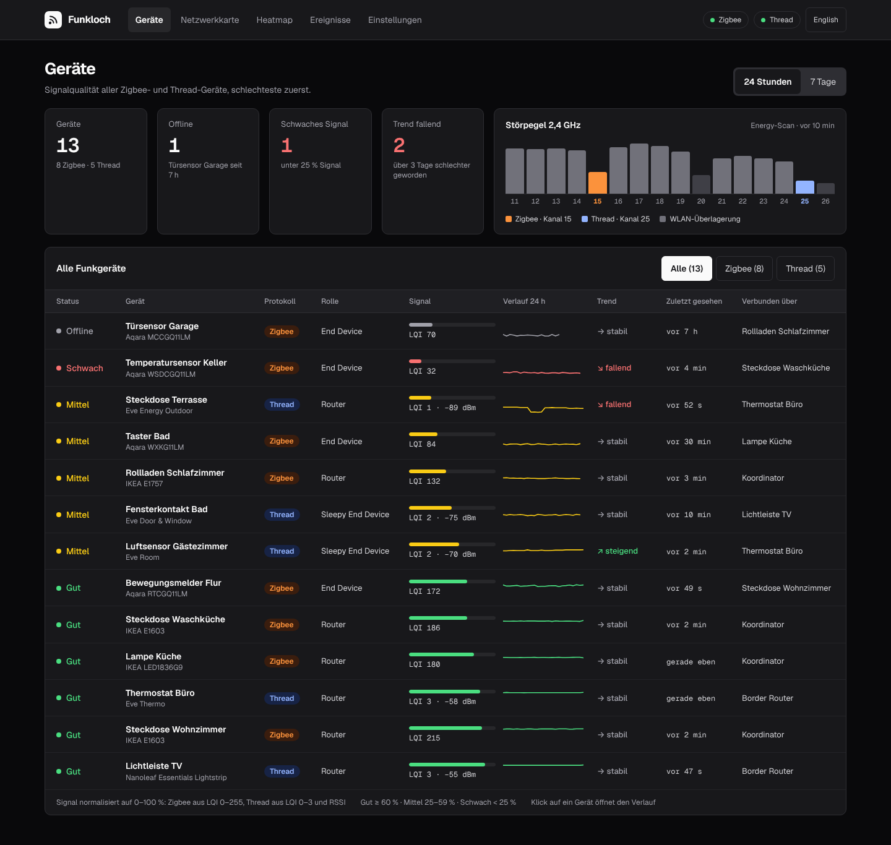

<div align="center">


<h1>Funkloch: signal history for Zigbee2MQTT and Thread devices</h1>

**A self-hosted dashboard that records the signal quality of every Zigbee2MQTT and Thread (OpenThread Border Router) device over time.**<br>
It shows which devices get worse over days, which drop out and how they are connected, instead of one snapshot.<br>
One Docker container next to Zigbee2MQTT and your OTBR, read-only, no cloud, open source.

[](https://github.com/firsttris/funkloch/actions/workflows/ci.yml)
[](https://github.com/firsttris/funkloch/releases/latest)
[](https://hub.docker.com/r/tristanteu/funkloch)

```bash
docker run -d --name funkloch --network host -v funkloch-data:/data \
  -e ZIGBEE2MQTT_MQTT_URL=mqtt://localhost:1883 tristanteu/funkloch
```

[Install](#-install) •
[Features](#-features) •
[Screenshots](#-screenshots) •
[Alternatives](#-funkloch-and-the-alternatives) •
[FAQ](#-faq)


</div>

## 💡 Why Funkloch?

Zigbee2MQTT shows the LQI of each device and a network map on request, the OpenThread Border Router
its neighbor table. Both are snapshots: they don't tell you that the sensor in the cellar has been
getting worse since Friday, or that the socket on the terrace drops every evening.

- **History instead of a snapshot**: every message is kept, condensed to hourly medians for a year.
- **Early warning**: falling trends, devices that go silent and parent changes stand out before a
  device is gone.
- **Both networks in one list**: Zigbee and Thread on one 0–100 % scale, each chart in its own raw
  unit (LQI, RSSI).
- **Read-only**: Funkloch never switches, pairs or reconfigures anything.

Runs on any Linux server, NAS or Raspberry Pi that runs Docker or Podman (amd64 and arm64).

## 🚀 Install

With Podman Quadlet (`~/.config/containers/systemd/funkloch.container`):

```ini
[Container]
Image=docker.io/tristanteu/funkloch:latest
Network=host
Volume=funkloch-data:/data
Environment=ZIGBEE2MQTT_MQTT_URL=mqtt://localhost:1883
Environment=TZ=Europe/Berlin
AutoUpdate=registry

[Install]
WantedBy=default.target
```

Or with Docker Compose:

```yaml
services:
  funkloch:
    image: tristanteu/funkloch:latest
    network_mode: host
    volumes:
      - funkloch-data:/data
    environment:
      ZIGBEE2MQTT_MQTT_URL: mqtt://localhost:1883
      TZ: Europe/Berlin
    restart: unless-stopped
volumes:
  funkloch-data:
```

Then open `http://<host>:8090`. Each network is on when its variable is set:

| Variable | Meaning | Default |
|---|---|---|
| `ZIGBEE2MQTT_MQTT_URL` | MQTT broker of Zigbee2MQTT, e.g. `mqtt://localhost:1883`; empty: Zigbee off | |
| `ZIGBEE2MQTT_MQTT_USER`, `ZIGBEE2MQTT_MQTT_PASSWORD` | broker login | |
| `ZIGBEE2MQTT_BASE_TOPIC` | Zigbee2MQTT base topic | `zigbee2mqtt` |
| `ZIGBEE2MQTT_NETWORKMAP_HOURS` | hours between two network maps, at least 1 | `6` |
| `OTBR_URL` | REST API of the OpenThread Border Router (Thread support follows) | |
| `PORT` | port of the web UI | `8090` |
| `DATA_DIR` | SQLite database | `/data` |
| `TZ` | time zone for day boundaries | `UTC` |
| `FUNKLOCH_DEMO` | `1` starts with a demo network instead | |

## ✨ Features

### 📶 Device list

- **Traffic light** per device from the median of the last hour: good, fair, weak, offline.
- **Sparkline** of the last 24 hours or 7 days, **trend** over 72 hours, last seen and the
  **parent** it is connected through.
- **Filter** by protocol; worst devices first.

### 📈 Device history

- **Raw value chart** (LQI or RSSI): every message for 24 hours, hourly median with min–max band
  for 7 and 30 days, offline stretches and the weak threshold drawn in.
- **Messages per hour**, **parent changes**, **connections** from the latest network map, and the
  device's **events**.

### 🔌 Reachability

- **Offline** when Zigbee2MQTT says so, or when a device stays silent for three times its usual
  interval (at least 30 minutes).

### 🗄️ Storage

- **One SQLite file**: raw readings for 14 days, hourly rollups for a year.

Network map, heatmap, Thread, events and notifications (ntfy, webhook, MQTT) follow; see the
roadmap in the issues.

## 📸 Screenshots

<table>
  <tr>
    <td></td>
    <td></td>
  </tr>
</table>

## 🔀 Funkloch and the alternatives

Funkloch is made for watching signal quality over time, not for controlling devices.

| | What it is | Where Funkloch differs |
|---|---|---|
| [Zigbee2MQTT frontend](https://www.zigbee2mqtt.io/guide/usage/frontend.html) | controls devices, shows current LQI and a network map | keeps the history and trends of every device |
| [Home Assistant](https://www.home-assistant.io/) | home automation with entity history | linkquality history only per entity, nothing for Thread links |
| Prometheus + Grafana with an exporter | general monitoring | no setup of exporters and dashboards, Thread included |

## ❓ FAQ

### Does Funkloch change anything in my Zigbee or Thread network?

No. It only listens to Zigbee2MQTT over MQTT and reads the OTBR REST API. The only requests it sends
are the Zigbee2MQTT network map (at most hourly, every 6 hours by default) and OTBR diagnostics.

### Does it work without Thread or without Zigbee?

Yes. Each network is on when its variable is set; with one network the protocol filter disappears.

### Can I try it without my own network?

Yes: `docker run --rm -p 8090:8090 -e FUNKLOCH_DEMO=1 tristanteu/funkloch` starts with a demo
network of 13 devices and 30 days of history.

## 🛠️ Development

Requires Bun 1.4 or newer.

```bash
git clone https://github.com/firsttris/funkloch && cd funkloch
bun install
bun run demo          # http://localhost:8090 with the demo network
```

Bun, TanStack Start (React), TanStack Router, Query and Table, Zod, SQLite with Drizzle, mqtt.js,
Tailwind 4, uPlot, Paraglide (German and English). Checks and architecture: [CLAUDE.md](CLAUDE.md).
Fixtures from your own network: [docs/recording.md](docs/recording.md).

## 🤝 Contributing

Issues and pull requests are welcome. A good bug report names the Zigbee2MQTT version or OTBR image
and, for parsing problems, includes a short recording from `bun run record`. Please run
`bun run typecheck && bunx biome ci . && bun run test` before opening a pull request.

---

<div align="center">

⭐ Like Funkloch? A [star on GitHub](https://github.com/firsttris/funkloch) helps others find it.<br>
🐛 [Report a bug](https://github.com/firsttris/funkloch/issues/new) · 💡 [Request a feature](https://github.com/firsttris/funkloch/issues/new)

<sub>© Tristan Teufel and contributors<br>
Funkloch is not affiliated with Zigbee2MQTT, the Connectivity Standards Alliance, the Thread Group or OpenThread.</sub>

</div>
