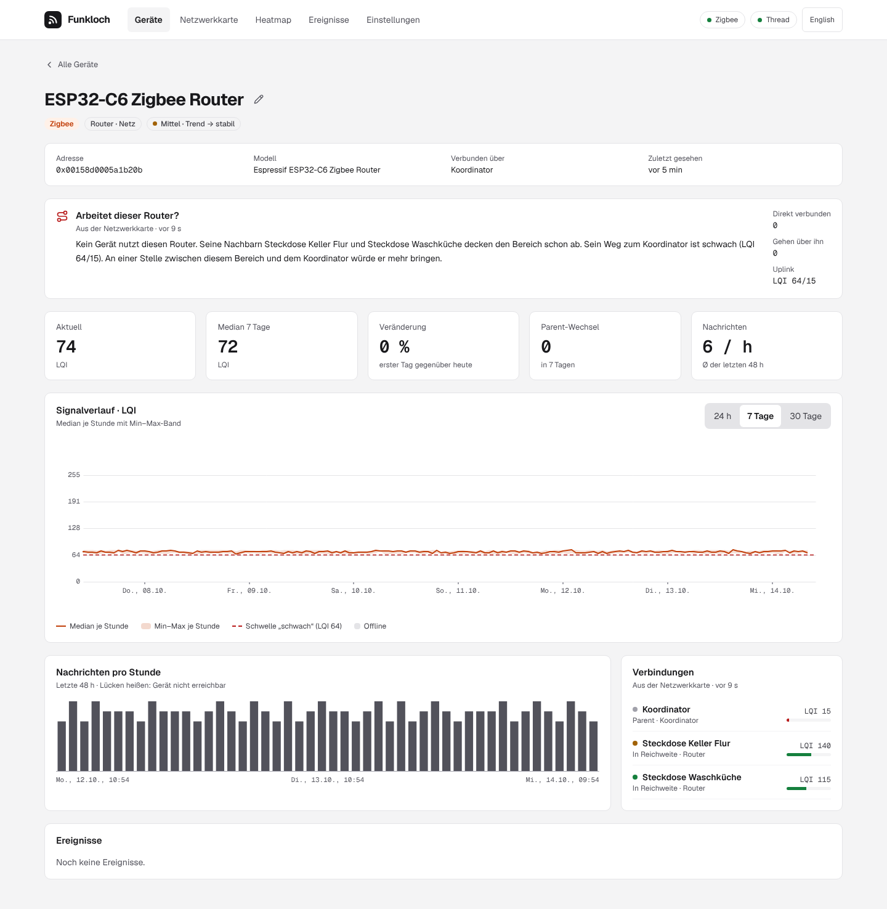

# Repeaters

A repeater is a router you add where devices receive poorly: a mains-powered Zigbee router, a
Thread router (a full Thread device), or an ESP32-C6 flashed as either with
[esp32c6-zigbee-router](https://github.com/firsttris/esp32c6-zigbee-router) or
[esp32c6-thread-router](https://github.com/firsttris/esp32c6-thread-router). Funkloch shows
whether devices actually use it and whether their signal got better.

## Where to look

- **The repeater's page**: *Is this router doing its job?* sums it up in a few sentences (below).
  Under **Connections**, *Connected through this device* counts the devices that use it as their
  parent. Each one has its traffic light and the date since when it is connected through the
  repeater.
- **The page of a device behind it**: the parent change is marked in the signal chart, so the
  history before and after the repeater sits side by side. *Connected through* names the repeater.
- **Network map**: the repeater's way to the coordinator or border router, with the link quality
  on every line, and the devices hanging on it.
- **Heatmap**: the hours turning from red to green from the day the repeater went in.
- **Events**: *parent changed* for each device that moves to the repeater (switch on the topology
  rule to be notified).

## Is this router doing its job?

Every router's page reads the newest network map and answers four questions, using the neighbor
tables only (no routing tables, see [Zigbee2MQTT](zigbee2mqtt.md)):



| | What Funkloch counts |
|---|---|
| **Connected directly** | devices whose parent it is |
| **Go through it** | every device whose way to the coordinator or border router leads through it, also behind another router |
| **Uplink** | its link to the next device towards the root, both directions: first how it hears that device, then how it is heard. The weaker one counts; below the *weak* threshold (score 25, e.g. LQI 64) the way is weak |
| **Covered** | every one of its neighbors (not the root, not the uplink) is heard at least as well by another router |

From these it writes what to do:

- **No device uses it, its way is weak**: *“Placed somewhere between this area and the
  coordinator, it would do more.”* The area around it is served already; what is missing is a
  strong step upwards. Move it half way to the coordinator (one floor up, near the stairs), where
  it still hears the routers of the area well and the coordinator better than they do.
- **Devices use it, its way is weak**: *“A router between it and the coordinator would strengthen
  the way for these devices.”* Leave it where it is and add one in between.
- **No device uses it, its neighbors are covered, its way is fine**: it stands by. That is not
  wasted: if one of its neighbors goes, devices can move to it.
- **Devices use it and its way is fine**: it does its job.

A Thread router whose transmit errors are marked says so as well: it often finds the channel busy
(see [Signal](signal.md#transmit-errors-thread-routers)). Move it away from Wi-Fi access points
and other transmitters, or put the Thread network on a channel away from the Wi-Fi.

A new router needs time: end devices change their parent only when the old link gets bad or
they rejoin. Look again after a day, or restart a device (re-insert the battery) to make it choose.

## Where the network is narrow

A router helps most where many devices share one weak link. For every parent link on the map
Funkloch counts the devices that hang on it: the device below and everything whose way leads
through it. A link that carries at least 3 devices and is weak (the weaker direction below the
*weak* threshold; for Thread from RSSI and link quality) is a **bottleneck**:

> 23 devices hang on Steckdose Keller Kleiner Raum ↔ Coordinator (LQI 55/35). A router between
> these two would strengthen the way.

The overview names it, the network map draws it thick and red and writes *Bottleneck · 23 devices*
under the device below it. **Show on the map** selects that device.

Where to put the router: between the two ends, where it hears both better than they hear each
other. In a house that is often the floor in between, near the stairs: a socket in the ground
floor halfway between a cellar socket and a coordinator upstairs. It takes over only when it is
better: give the devices a day, then look at the bottleneck again.

The map comes from the neighbor tables only (`routes: false`): Funkloch's uplinks are its reading
of the map (below), not the routes the network takes. Asking for the routing tables would cost a
timeout of about 25 seconds for every router that does not answer them (Tuya TS011F among them).

## Zigbee: a router that sends nothing itself

A pure repeater has no sensors, so it never sends a state message, and Zigbee2MQTT publishes
nothing for it. Funkloch then takes its signal from the network map: the LQI of its link towards
the coordinator, every time a map is read (every 6 hours by default). It does so only for routers
that sent no reading of their own in the last two hours.

For a reading every 10 minutes instead, set two options in Zigbee2MQTT's `configuration.yaml` (or
under **Settings** in its frontend) and restart it:

```yaml
advanced:
  # publish the device state, linkquality included, on every message, not only on changes
  last_seen: ISO_8601
availability:
  # ping routers that stay silent; 10 minutes is the default for mains-powered devices
  enabled: true
  active:
    timeout: 10
```

With availability on, Zigbee2MQTT pings a silent router every 10 minutes; with `last_seen` on,
the answer is published with its `linkquality`, which Funkloch takes as a reading. Availability
also tells Funkloch at once when the repeater is unplugged. Both options are from Zigbee2MQTT's
`lib/util/settings.schema.json`.

Nothing changes on the repeater itself: the ESPHome configuration stays as it is.

## Thread: router-eligible and router

A Thread repeater joins as a child first: *router-eligible (REED)*. Thread makes it a router only
when the mesh needs one, which can take minutes or not happen in a small network. Funkloch shows
the role and reports the promotion as *role changed*. Its signal is how its parent (as a child) or
the best neighboring router (as a router) hears it, every 5 minutes, with border router images that
have the `/api` resources (see [Thread](thread.md)).

Nothing changes on the repeater or the border router for this.

## How the way to the root is drawn

Routers have no parent: Zigbee neighbor tables list them as siblings, Thread routers talk as
equals. Funkloch gives each router an uplink: of its neighbors one hop closer to the coordinator or
border router, the one with the best link. That is the line drawn as its parent on the map and the
device named under *Connected through*; it is Funkloch's reading of the map, not a route the
network reports.
