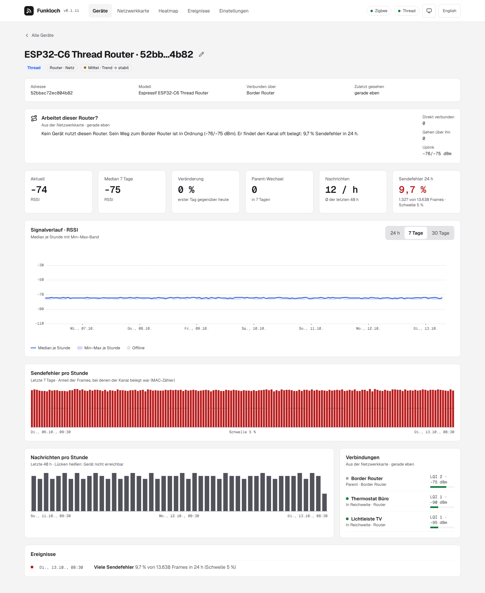

# Signal, trend and reachability

## Score

Every reading becomes a score from 0 to 100, so Zigbee, Thread and Wi-Fi fit on one scale:

| Network | Score | Chart shows |
|---|---|---|
| Zigbee | LQI / 255 × 100 | LQI 0–255 |
| Thread | RSSI from −100 dBm (0) to −50 dBm (100), capped by the link quality: LQI 3 → 100, 2 → 59, 1 → 24, 0 → 0 | RSSI in dBm |
| Wi-Fi (Matter) | RSSI from −90 dBm (0) to −50 dBm (100) | RSSI in dBm |

The score drives the traffic light, the heatmap and the events; the charts keep the network's own
value. LQI values of different Zigbee chips are not strictly comparable; the history of one device
says more than the comparison of two.

## Traffic light

| | Score of the last 60 minutes (median) |
|---|---|
| **Good** | 60 and more |
| **Fair** | 25 to 59 |
| **Weak** | below 25 |
| **Offline** | not reachable (below) |
| **Unknown** | no reading yet |

Without a reading in the last hour the latest hourly median counts. Both thresholds can be
changed under **Settings**.

## Trend

A linear regression over the hourly medians of the last 72 hours, read as the change it predicts
over those 72 hours: more than 15 points down is **falling**, more than 15 up **rising**. It needs
at least 24 hourly values; a single bad reading does not move it. Each hour of the day first loses
its own mean over the window, so a daily rhythm (a socket that is weak every evening) is no trend
and the verdict does not change with the time of day; a change from day to day still counts.

## Reachability

A device is **offline** when

- Zigbee2MQTT or matterjs-server reports it offline (availability, or a Matter node the server
  cannot reach), or
- it has been silent for three times its usual interval between messages, at least 30 minutes.
  The usual interval is the gap a moment of the last 7 days typically falls into (the median of
  the gaps, weighted by their length), so a remote that sends bursts of presses seconds apart
  keeps the long pauses between them as its interval.

A device without a known interval is judged by the report only. Coordinators, border routers and
access points are never marked offline from silence; their state comes from the bridge.

## Recurring patterns

Once a day (3 a.m.) Funkloch looks at the last 7 days by hour. A device that is weak at the same
hours on at least 5 of 7 days (a window of at most 12 hours), and rarely weak outside it, gets a
**recurring pattern**: typically Wi-Fi load in the evening or a device that runs at that time.

## Transmit errors (Thread routers)

With every reading (every 5 minutes) Funkloch asks each Thread router for its MAC counters
(`macCounters` in the network diagnostics). They count up from the router's start, so Funkloch
works with the difference between two readings; a counter lower than before means the router
restarted, and the new value counts from zero. The transmit error rate is

> Δ`ifOutErrors` / (Δ`ifOutUcastPkts` + Δ`ifOutBroadcastPkts`)

OpenThread fills `ifOutErrors` with the failed clear channel assessments (`mTxErrCca` in openthread
`src/core/thread/net_diag_tlvs.cpp`): the router wanted to send and found the channel busy. The
packet counters count each frame once, however often it was retried (`include/openthread/link.h`).
The rate therefore says how often the router cannot get on air: Wi-Fi or another transmitter close
to it, or a radio that hears the channel as busy. Its RSSI does not show this: a router can be
heard well and still fail to send.

The router's page shows the rate of the last 24 hours and one bar per hour over 7 days (an hour
with fewer than 20 frames has none). From **5 %** over 24 hours the rate is marked and becomes the
event *many transmit errors*; below 3 % it is *back to normal*. Fewer than 200 frames in 24 hours
give no rate.

Why 5 %: routers on a quiet channel stay far below 1 % (on the network that led to this check, the
other routers below 0.1 %, an ESP32-C6 router in the cellar at about 10 %). 5 % is fifty times the
normal case and means one frame in twenty met a busy channel, while an hour of Wi-Fi load or a
microwave does not reach it over 24 hours.

## Storage

| Data | Kept |
|---|---|
| every reading, the transmit counters | 14 days (2–90) |
| hourly median, min, max, message count, minutes offline | 365 days (30–3650) |
| network maps | as long as the hourly values |
| events | as long as the hourly values |
